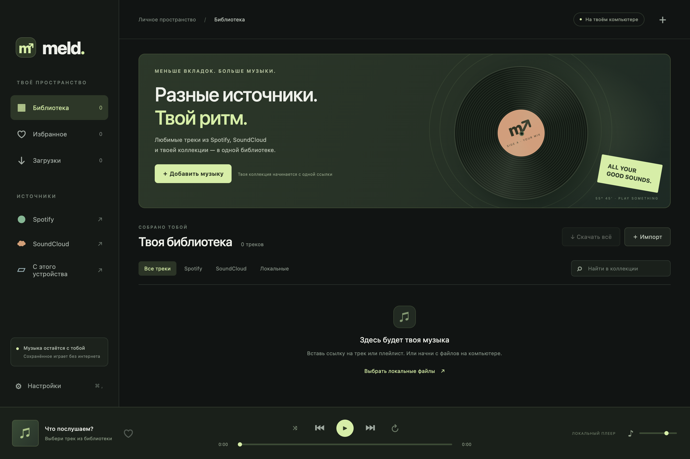

# Meld 0.1.0

Десктопный музыкальный плеер для macOS Apple Silicon и Windows x64.



**[Скачать приложение для macOS или Windows](https://github.com/magicpve-hue/meld-music/releases/latest)** · [Исходники](https://github.com/magicpve-hue/meld-music) · [Изменения](CHANGELOG.md)

Spotify используется для списка песен; звук подбирается на YouTube через spotDL. SoundCloud обрабатывается через yt-dlp. Это локальный плеер с загрузкой файлов, а не доступ ко всему каталогу Spotify.

## Запуск

**macOS (M1/M2/M3/M4 и другие Apple Silicon):** распакуйте `Meld-0.1.0-macOS-AppleSilicon.zip`, перенесите `Meld.app` в «Программы» и откройте. Сборка имеет локальную ad-hoc подпись, но не подписана сертификатом разработчика Apple и не нотарифицирована. Если macOS блокирует первый запуск, используйте «Системные настройки → Конфиденциальность и безопасность → Всё равно открыть» для этого приложения. Intel Mac в этой версии не поддерживается.

**Windows x64:** распакуйте весь архив `Meld-0.1.0-Windows-x64.zip` в отдельную папку и запустите `Meld.exe`. Файлы рядом с `.exe` необходимы. Это переносимая сборка, установщик не нужен. Подписи издателя нет; Windows может показать предупреждение о неизвестном приложении. Windows-версия собрана на macOS; фактический запуск на Windows требует отдельной проверки.

Для работы загрузчиков требуются совместимые современные версии ОС, поддерживаемые Electron 45 и используемыми движками. Загрузка из сети зависит от доступности GitHub, Spotify, SoundCloud и YouTube в вашей сети.

## Первый импорт

1. Откройте «Настройки → Установить движки». Приложение скачает spotDL, yt-dlp, FFmpeg, FFprobe и Deno из зафиксированных релизов разработчиков. Загрузка составляет примерно 200–300 МБ; каждый файл проверяется по SHA-256. Python, Node.js и терминал для пользователя не нужны.
2. Нажмите «Добавить музыку» и вставьте полную публичную ссылку `https://open.spotify.com/track/...`, `/album/...`, `/playlist/...` или ссылку на трек / плейлист `https://soundcloud.com/...`.
3. Импорт добавляет список треков. Он не начинает массовое скачивание сам. Нажмите стрелку у нужного трека или выделите несколько записей и нажмите «Скачать».
4. После загрузки нажмите обложку или название. Аудиофайлы доступны без интернета.

Также можно сразу добавить локальные MP3, M4A, WAV, OGG, FLAC, OPUS или AAC через кнопку «＋» вверху. Файлы копируются в папку библиотеки. Поддержка конкретного кодека зависит от Electron/Chromium.

**Что означает Spotify:** spotDL импортирует метаданные Spotify, подбирает запись на YouTube и сохраняет её в MP3. Аудио не извлекается из Spotify, Premium-качество Spotify не обещается. Автоматическое сопоставление может выбрать другую версию композиции. Для SoundCloud используется yt-dlp. Закрытые, платные, удалённые и регионально ограниченные записи могут быть недоступны. Здесь нет снятия DRM и обхода платного доступа. Сохраняйте записи, скачивание которых вам разрешено.

## Что есть

- Импорт публичного трека, альбома или плейлиста Spotify через spotDL.
- Импорт трека или плейлиста SoundCloud через yt-dlp; до 500 записей за импорт.
- Локальная коллекция, поиск по названию / исполнителю, фильтры, избранное.
- Последовательная очередь загрузок, проценты при наличии их у источника, отмена и повтор, сохранение результата. Проверка аудиодорожки через FFprobe перед добавлением файла.
- Пауза, перемотка, предыдущий / следующий трек, перемешивание, повтор, громкость.
- Открытие исходной страницы и папки с файлом.
- Сохранение библиотеки между запусками. Прерванные задачи можно повторить вручную. Удаление записи из списка не удаляет аудиофайл.
- Необязательные собственные Client ID / Client Secret Spotify. Ключи шифруются системным хранилищем. Они передаются локальному процессу spotDL и могут быть видны процессам с доступом к списку аргументов; не используйте здесь ключи публичного серверного приложения.

Не реализованы: синхронизация приватных плейлистов и «Любимых треков» через OAuth, редактор плейлистов, аккаунты/облако, кроссфейд и потоковое воспроизведение до завершения загрузки. Публичное распространение/монетизация интеграций требует отдельной проверки условий платформ.

## Если источник отказал

В разделе «Загрузки» доступны ошибка, последняя строка журнала и кнопка «Повторить». Ограничения 403/429, запрос входа или антибот-проверка не обходятся автоматически. Если Spotify отклоняет импорт, можно попробовать ключи своего приложения в настройках; это не гарантирует доступ к любому плейлисту. Короткие ссылки сначала раскройте в браузере и скопируйте полный адрес.

Движки закреплены по версиям. Переустановка скачивает те же проверенные версии. Для обновления разработчик выполняет `node scripts/refresh-tools.cjs`, проверяет новые инструменты и пересобирает приложение.

## Где хранятся данные

- macOS: `~/Library/Application Support/Meld/`
- Windows: `%APPDATA%/Meld/`
- `library.json` — список треков, избранное и задания; `audio/` — копии и скачанные файлы; `tools/` — движки и их кэш; `credentials.bin` — необязательные зашифрованные ключи.

Не публикуйте свою папку данных: она может содержать приватные ссылки SoundCloud и ключи. В исходниках и дистрибутивах пользовательских данных нет. Если `library.json` повреждён, приложение сохраняет копию `.recovery-*`; существующее аудио не удаляется.

## Для разработки

Требуется Node.js 22+ и npm либо pnpm.

```sh
git clone https://github.com/magicpve-hue/meld-music.git
cd meld-music
npm install
npm test
npm start
```

Для запуска только тестов достаточно клонировать репозиторий, выполнить `cd meld-music` и `npm test`: npm-зависимости и сетевой доступ тестам не нужны. Автоматический workflow проверяет тесты на Linux, macOS и Windows.

Для воспроизводимой установки версий зависимостей приложен `pnpm-lock.yaml`: используйте `pnpm install --frozen-lockfile`, затем `node node_modules/electron/install.js`, если установка lifecycle-скриптов отключена в вашем окружении.

Правила участия: [CONTRIBUTING.md](CONTRIBUTING.md). Код приложения распространяется по лицензии [MIT](LICENSE); лицензии загрузчиков перечислены в [THIRD_PARTY.md](THIRD_PARTY.md).

Исходники: `src/main.cjs` — окно и IPC, `src/core.cjs` — библиотека и загрузки, `src/tools.cjs` — установка проверенных движков, `src/media.cjs` — выдача локального аудио с byte-range, `src/renderer.js` — интерфейс.

`node scripts/package.cjs` создаёт оба ZIP-архива на macOS (использует системные `ditto` и `codesign`). Скрипт пакует чистую промежуточную папку без dev-зависимостей и пользовательских данных. `scripts/live-check.cjs <папка-данных>` проверяет реальные импорты, не скачивая аудио автоматически.

Архитектура допускает добавление других провайдеров, но произвольные HTTP API, парсеры неизвестных «Spotify MP3» сайтов, cookies браузера и пароли пользователей в эту версию не включены.
